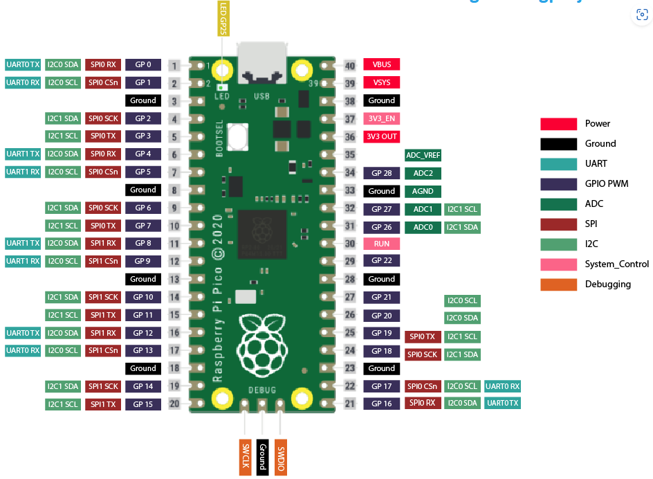
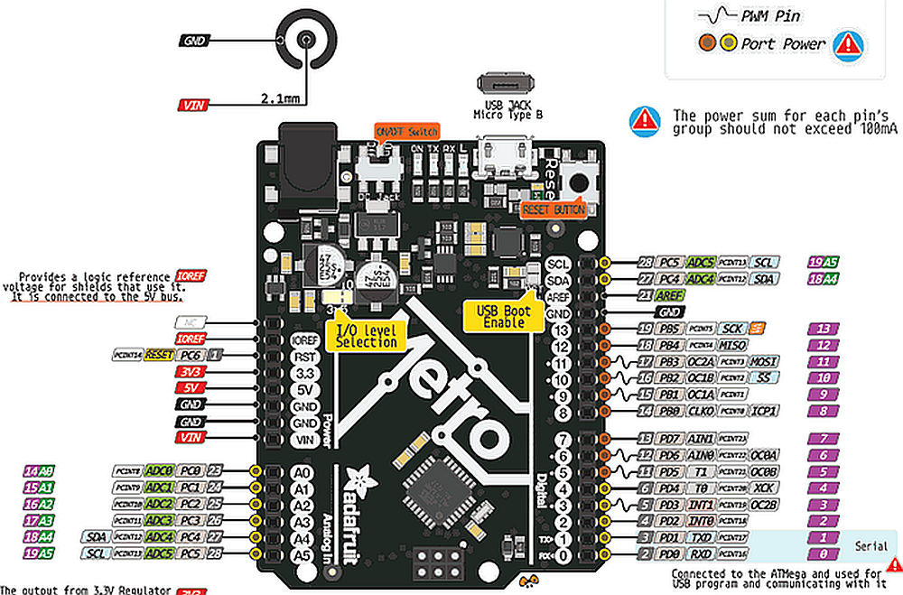

|[:skull:ISSUE](https://github.com/frankyhub/RPIpicoESP-Python/issues?q=is%3Aissue)|[:speech_balloon: Forum /Discussion](https://github.com/frankyhub/RPIpicoESP-Python/discussions)|[:grey_question:WiKi](https://github.com/frankyhub/RPIpicoESP-Python/wiki)||
|--|--|--|--|
| | | | |
<a href="https://github.com/frankyhub/RPIpicoESP-Python/issues">|<a href="https://github.com/frankyhub/RPIpicoESP-Python/discussions">|<a href="https://github.com/frankyhub/RPIpicoESP-Python/6eleases">||
|| <a href="https://github.com/frankyhub/RPIpicoESP-Python/pulse" alt="Activity">| <a href="https://github.com/frankyhub/RPIpicoESP-Python/graphs/traffic">  |<a href="https://github.com/frankyhub?tab=stars"> ||

# RPIpico-ESP-Python
Micro Python mit dem  Raspberry Pi Pico/Pico W

 
   

 
   

---
